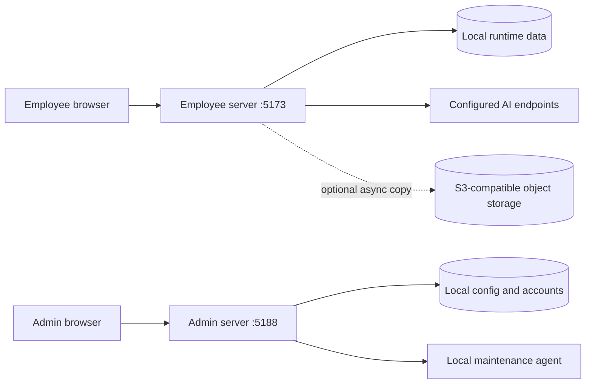

# AI Creative Canvas

An open-source, local-first workspace for AI image creation, product asset management, detail-page composition, and infinite-canvas iteration.

[](./LICENSE)
[](./package.json)
[](./OPEN_SOURCE_RELEASE_CHECKLIST.md)

**Languages:** [English](./README.md) · [简体中文](./docs/i18n/README.zh-CN.md) · [日本語](./docs/i18n/README.ja.md) · [한국어](./docs/i18n/README.ko.md) · [Español](./docs/i18n/README.es.md) · [Português](./docs/i18n/README.pt-BR.md) · [Français](./docs/i18n/README.fr.md) · [Deutsch](./docs/i18n/README.de.md) · [Русский](./docs/i18n/README.ru.md) · [العربية](./docs/i18n/README.ar.md)

> This repository is a sanitized technical preview. It is designed for local or private-network deployment and does not include the original project's private data, credentials, templates, or brand assets.

## What it is

AI Creative Canvas keeps the working data on the local appliance by default. A browser-based employee workspace handles generation and canvas editing, while a separate administrator workspace manages accounts, model routes, usage, maintenance, and optional cloud backups.

The cloud layer is deliberately optional: local storage remains the source of truth, and an S3-compatible bucket can receive asynchronous copies of conversations, canvas projects, and selected image assets.

## Highlights

- **AI image workspace** — prompt-driven generation, references, image continuation, prompt copy, and task history.
- **Infinite canvas** — frames, text, shapes, image assets, layer operations, zoom, pan, and project snapshots.
- **Detail-page composition** — spreadsheet-guided planning and multi-screen composition for long product pages.
- **Account and usage controls** — local accounts, sessions, quotas, feedback, and per-user task limits.
- **User-selected image models** — each user can maintain a browser-local list of model names; service endpoints and credentials stay administrator-controlled.
- **Local-first persistence** — conversations, canvas projects, and local assets are written to `runtime/` on the appliance.
- **Optional cloud backup** — reuse generic S3-compatible object storage without binding the runtime to a vendor.
- **Open-source boundaries** — Apache-2.0 license, third-party notices, security guidance, and a release checklist are included.

## Product tour and cases

The repository includes three documented workflows. They describe the intended inputs, steps, outputs, and boundaries without inventing performance claims:

1. [Product main image](./docs/CASES.md#case-1-product-main-image)
2. [Long detail page](./docs/CASES.md#case-2-long-detail-page)
3. [Canvas iteration and backup](./docs/CASES.md#case-3-canvas-iteration-and-backup)

## Architecture



Local runtime data is the primary copy. Cloud backup is opt-in and is never required for the employee workspace to read or save local work.

## Quick start

### Requirements

- Node.js 24 or newer
- A local or private-network machine
- An administrator account created on first launch
- AI service credentials configured through the administrator workspace or environment variables

### Start the employee workspace

```bash
npm install
npm start
```

Open <http://127.0.0.1:5173>.

### Start the administrator workspace

```bash
npm run admin
```

Open <http://127.0.0.1:5188>. There is no default administrator password.

### Run the test suite

```bash
npm test
```

### Build a source archive

```bash
npm run check:fonts
npm run package:source
```

The source packager excludes Git history, dependencies, runtime data, outputs,
temporary files, and local environment files. It stops instead of packaging if
it finds a font binary by extension or known font-file signature.

## Runtime parameters

| Parameter | Default | Purpose |
| --- | ---: | --- |
| `PORT` | `5173` | Employee workspace HTTP port |
| `ADMIN_PORT` | `5188` | Administrator workspace HTTP port |
| `ECOM_EMPLOYEE_HOST` | `127.0.0.1` | Employee listener; set to `0.0.0.0` only for an intentionally protected LAN deployment |
| `ECOM_ADMIN_HOST` | `127.0.0.1` | Admin listener; set to `0.0.0.0` only for an intentionally protected LAN deployment |
| `ECOM_CONFIG_SECRET_KEY` | local key file | Optional 32-byte Base64/hex key for encrypting stored service credentials |
| `ECOM_COOKIE_SECURE` | `0` | Set to `1` when both workspaces are served only through HTTPS |
| `ECOM_ALLOW_REMOTE_UPDATE` | `0` | Explicit opt-in for HTTPS update URLs; every package still requires SHA-256 |
| `MAX_IMAGE_UPLOAD_MB` | `64` | Maximum image upload size; bounded to 1–128 MB |
| `MAX_JSON_BODY_MB` | `128` | Maximum JSON request body; bounded to 2–512 MB |
| `AI_IMAGE_MAX_CONCURRENCY` | `8` | Appliance-wide image task concurrency; bounded to 1–12 |
| `AI_IMAGE_MAX_ACTIVE_JOBS` | `50` | Appliance-wide active task limit; bounded to 8–500 |
| `AI_IMAGE_MAX_ACTIVE_JOBS_PER_USER` | `8` | Per-user active task limit |
| `APP_AI_TIMEOUT_MS` | `600000` | AI request timeout in milliseconds |
| `PRIMARY_IMAGE_API_BASE_URL` | empty | Primary compatible AI endpoint base |
| `PRIMARY_IMAGE_MODEL` | empty | Default primary image model |
| `SECONDARY_IMAGE_API_BASE_URL` | empty | Optional secondary compatible endpoint base |
| `SECONDARY_IMAGE_MODEL` | empty | Optional secondary image model |

Stored service credentials are encrypted with AES-256-GCM. By default the key is
created as `runtime/intranet/secret-key.bin`; back it up together with the
configuration and account database, and restrict access with operating-system
permissions. Do not commit `.env`, the key file, API keys, sessions, or any
`runtime/` data.

## Optional cloud backup

1. Start the administrator workspace and open **AI settings → Object storage**.
2. Enter an S3-compatible endpoint, region, bucket, access key, and secret key.
3. Enable **Cloud backup** and choose projects, conversations, and associated assets.
4. Keep local storage enabled. Local writes complete first; cloud uploads are asynchronous.

The default object layout is:

```text
backups/<user>/projects/<project-id>/<project-id>.json
backups/<user>/conversations/<conversation-id>/<conversation-id>.json
```

The cloud copy is a backup record. The employee workspace continues to read from the local appliance.

## Project layout

| Path | Role |
| --- | --- |
| `server.js` | Employee HTTP server, AI routes, local persistence, and cloud-copy worker |
| `admin-server.js` | Administrator HTTP server and configuration management |
| `public/` | Employee workspace frontend |
| `admin-public/` | Administrator workspace frontend |
| `runtime/` | Local runtime data; ignored from source releases |
| `docs/` | Architecture, configuration, cases, and translated project introductions |
| `tests/` | Node test suite and security boundary checks |
| `THIRD_PARTY_NOTICES.md` | Third-party attribution and license notices |

## Documentation

- [Configuration reference](./docs/CONFIGURATION.md)
- [Architecture and data boundaries](./docs/ARCHITECTURE.md)
- [Workflow cases](./docs/CASES.md)
- [Localization guide](./docs/LOCALIZATION.md)
- [Contributing guide](./CONTRIBUTING.md)
- [Security policy](./SECURITY.md)
- [Privacy and data deletion](./PRIVACY.md)
- [Acceptable-use and generated-content rules](./ACCEPTABLE_USE.md)
- [Ownership and provenance record](./OWNERSHIP_PROVENANCE.md)
- [Open-source release checklist](./OPEN_SOURCE_RELEASE_CHECKLIST.md)
- [Apache-2.0 license](./LICENSE)

## Current limitations

- The release is a local/private-network preview, not a hosted multi-tenant SaaS product.
- Cloud backup does not yet provide employee-side cloud restore or conflict resolution.
- AI provider availability, model capabilities, cost, and output quality depend on the endpoints configured by the administrator.
- Generated images and text still require human review before commercial use.
- Operators remain responsible for notices, consent, AI-content labeling, and regulated-industry requirements in their jurisdiction.

## Contributing

Small, focused pull requests are welcome. Before opening one, run `npm test`, keep credentials and runtime data out of the patch, and update the relevant documentation when behavior changes.

## License

This project is released under the [Apache License 2.0](./LICENSE). Third-party components remain under their respective licenses listed in [THIRD_PARTY_NOTICES.md](./THIRD_PARTY_NOTICES.md).
