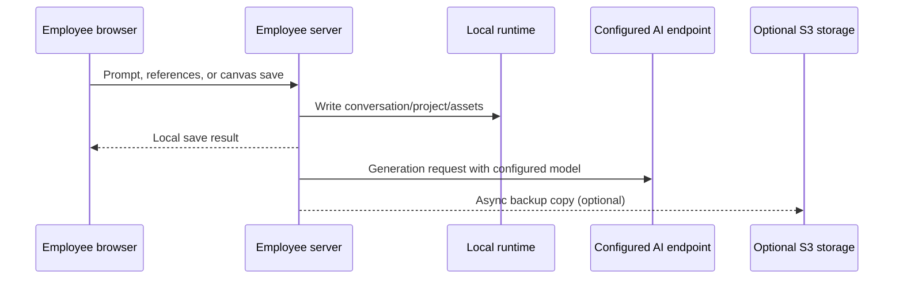

# Architecture and data boundaries

## Request paths

The local write is intentionally independent from the cloud upload. A cloud timeout or permission error is logged and does not turn a successful local save into a failed employee request.

## Storage locations

| Data | Local path | Cloud behavior |
| --- | --- | --- |
| AI conversations | `runtime/ai-conversations/<user>/` | Optional JSON snapshot and conversation assets |
| Canvas projects | `runtime/canvas-beta/projects/<user>/` | Optional JSON snapshot and referenced canvas assets |
| Canvas assets | `runtime/canvas-beta/assets/<user>/` | Uploaded only when the cloud asset switch is enabled |
| Accounts and sessions | `runtime/accounts/` | Never copied by the cloud backup worker |
| AI keys and config | encrypted fields in `runtime/intranet/config.json` | Never exposed to employees or copied as project data |
| Encryption key | `runtime/intranet/secret-key.bin` or environment | Never copied to project/cloud data; must be protected and backed up separately |
| Deletion records | `runtime/data-deletion/` | Tracks local cleanup and optional cloud-prefix deletion |

## Security boundaries

- Employee and administrator sessions use separate cookies and routes.
- Both services bind to `127.0.0.1` by default; LAN exposure is an explicit deployment choice.
- First administrator setup is accepted only from a loopback client.
- State-changing cross-site requests are rejected and responses include restrictive security headers.
- Object-storage credentials are administrator configuration, not browser configuration.
- Stored service credentials and per-user keys are encrypted with AES-256-GCM.
- Cloud object keys are scoped by sanitized user ID, resource kind, and resource ID.
- Deleting an account also removes sessions, usage rows, local conversations, projects, assets, feedback, gallery items, and queues optional remote-prefix deletion.
- Remote image references are not accepted as local canvas assets for background removal.
- Runtime data is excluded from source archives and must remain outside public repositories.
